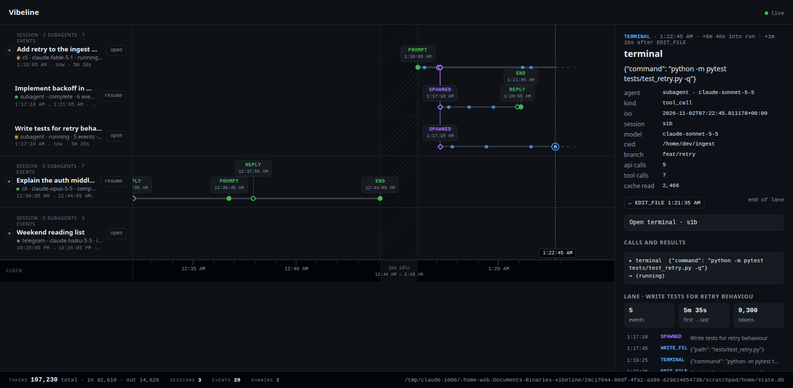
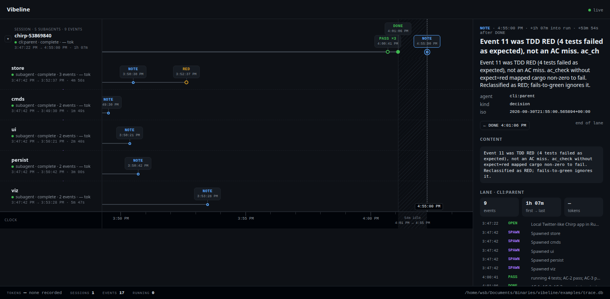
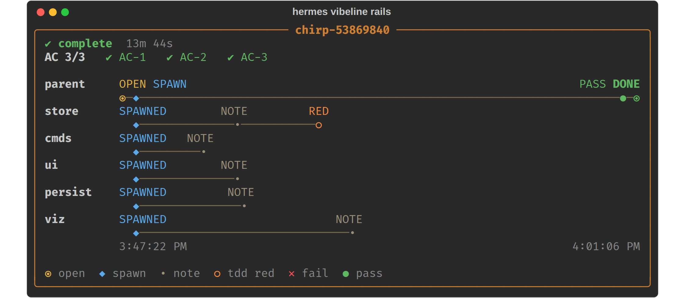

# vibeline

A [Hermes](https://github.com/NousResearch/hermes-agent) plugin that shows agent work as **rails**: one lane per
agent, child lanes branching at spawn, tool calls and acceptance-criteria results as marks along the track.

Three surfaces, same data:

| Surface | Command | What you get |
|---|---|---|
| Hermes TUI | `/rails` | Ink widget inside `hermes --tui` (parent/child rails, inspector, Esc/q closes) |
| Web | `hermes vibeline web --open` | Live page: every Hermes session on the machine (or several machines), Kanban Swarm runs, the harness ledger; stopwatch heatmap, feedback export, rewind and retry |
| CLI / model | `hermes vibeline rails`, tool `vibeline_rails` | Rich panel in the terminal, markdown for the model |

Runtime dependencies: Python 3.10+ standard library only. `rich` is used if present (Hermes ships it).

## Screenshots

**Web UI, Sessions view.** Every Hermes session on the machine, subagents as child rails branching at spawn,
tool calls as dots. Clicking a mark opens the inspector on the right.



**Web UI, Ledger view** (`/?src=ledger`). The harness task ledger: parent lane, five spawned workers, the
expected TDD RED on `store`, and the acceptance-criteria PASS/DONE on the parent.



**Classic CLI panel** (`hermes vibeline rails`). The same ledger as a Rich panel in the terminal.



The web captures use a mock `state.db` and the bundled sample ledger, so what you see on a fresh install matches.

## Quick start (5 minutes)

```bash
git clone git@github.com:ListeningPost/vibeline.git ~/vibeline
cd ~/vibeline
./install.sh                            # links into ~/.hermes/plugins, enables, runs self-check
```

The install script is idempotent. It refuses to overwrite a plugin link that points somewhere else.

Then:

```bash
hermes --tui            # inside the TUI type:  /rails
hermes vibeline web --open
```

With no ledger configured, vibeline renders the bundled sample at `examples/trace.db` so you can see it work
before pointing it at real data. The Sessions tab of the web UI needs no configuration at all. It reads Hermes's
own `~/.hermes/state.db` read-only.

## Web UI features

**Stopwatch (`h`).** Colours every step by how long it took: blue fast, yellow typical, red with a glowing
outline slow. *Tool time* is the assistant message to the last tool result; *model wait* is the gap before a
step. `auto` compares a tool with its own median on screen (slow = 3x typical and at least 2s); pick a fixed
threshold (1s to 5m) instead if you prefer, and tick *slow only* to hide the rest. `?heat=1` opens a link in
this mode.

**Feedback (`f`).** Rate any step 👍 / 😐 / 👎, add a note saying why, and tick "*tool* is performing poorly"
to flag a tool across every call. Ratings live in `~/.hermes/vibeline/feedback.db` (override with
`VIBELINE_FEEDBACK_DB`), never in Hermes's own database. Export from the header links or the CLI:

```bash
hermes vibeline feedback --format csv --out feedback.csv     # or --format jsonl, --rated-only
```

One row per step of every session that has feedback (unrated steps ride along as context, with an empty
`rating`). Columns: `machine, session_id, session_title, agent, lane_id, lane_name, event_id, time, kind,
label, tools, title, content, duration_ms, wait_ms, rewound, rating, note, tool_flagged, tool_note`. Tool
arguments and results inside `content` are capped at 1,500 characters each.

**Rewind and retry.** Select any step on a session's own rail and use *Rewind to this prompt and retry* (two
clicks: the first says how many steps will be dropped). vibeline calls Hermes's `SessionDB.rewind_to_message`,
the call behind `/rewind`, then opens a terminal on the session with the prompt resubmitted (`hermes chat
--resume ID -q PROMPT`). The dropped steps are soft-deleted by Hermes and stay on the rail as ghosts. It
rewinds the conversation only: files the agent changed are not restored, a session mid-turn is refused, and a
terminal still attached to the session should be closed first. Needs the UI started through Hermes
(`hermes vibeline web`), not standalone. CLI: `hermes vibeline rewind SESSION_ID m1234 [--dry] [--no-retry]`.

**Swarm tab (`?src=swarm`).** Hermes Kanban Swarm runs (`hermes kanban swarm`), read from `kanban.db` and any
named boards: the root card is the parent rail with its blackboard updates, and each worker, the verifier and
the synthesizer is a child rail with claims, comments, failures and run outcomes. Card-level only: a worker's
individual tool calls are on its own session in the Sessions tab.

## Several machines

Each machine runs its own vibeline; one of them also shows the others.

```bash
# on every other machine (prints a URL containing a generated token)
hermes vibeline web --host 0.0.0.0 --name gpu-box

# on the machine you look at
hermes vibeline web --open --peer gpu-box=http://gpu-box:8877/?token=... --peer laptop=http://...
```

Sessions and swarms from every reachable machine are merged onto one page, labelled by machine; an unreachable
one is marked down and the rest keep working. Open, resume and rewind are forwarded, so the terminal opens on
the machine that owns the session. A machine with no graphical session (a server, a GPU box) starts the session
in a detached tmux session instead and the page shows the command to attach, e.g. `tmux attach -t
vibeline-<session>`; run it there over SSH. `VIBELINE_TERMINAL=tmux` forces this on a desktop too. Feedback is
stored on the machine you look at, tagged with the source machine.

- Anything other than loopback requires the token (`--token`, `VIBELINE_TOKEN`, or generated). Loopback clients
  are trusted as before.
- Whoever holds a machine's token can read its sessions and open or rewind them. Add `--read-only` on a
  machine to refuse those actions and only publish its rails.
- Traffic is plain HTTP. Use it on a network you trust, a VPN/tailnet, or an SSH tunnel.
- `VIBELINE_PEERS` accepts the same `NAME=URL` entries, space or comma separated.

## Manual install

If you prefer not to run the script:

```bash
ln -sfn /path/to/vibeline ~/.hermes/plugins/vibeline
hermes plugins enable vibeline
hermes vibeline check
```

`hermes vibeline check` verifies Python version, plugin link, ledger, `state.db`, widget directory and terminal
emulator. It exits non-zero on a hard failure. Run it first whenever something looks off.

## Pointing at a real ledger

The harness ledger is an append-only SQLite file written by the harness MCP (table `events`, hash-chained).
vibeline only reads it. Resolution order:

1. `--db PATH` on the command line, or the `db` argument on the tool
2. Plugin setting `plugins.entries.vibeline.settings.db` in `~/.hermes/config.yaml`
3. `VIBELINE_DB`, then `TRACE_DB` environment variables
4. `~/.hermes/vibeline/trace.db`
5. The bundled sample `examples/trace.db`

To set it once:

```bash
./install.sh --db /path/to/trace.db
# or
hermes config set plugins.entries.vibeline.settings.db /path/to/trace.db
```

Equivalent YAML:

```yaml
plugins:
  entries:
    vibeline:
      settings:
        db: /path/to/trace.db
        show_tokens: false
```

## Everyday commands

```bash
hermes vibeline rails [TASK_ID] [--db PATH] [--tokens]   # latest task if TASK_ID omitted
hermes vibeline dashboard                                 # task x AC table
hermes vibeline tasks                                     # list task ids
hermes vibeline web [--port 8877] [--host 127.0.0.1] [--open]   # tabs: Sessions, Swarm, Ledger
                    [--peer NAME=URL]... [--token T] [--name N] [--read-only]
hermes vibeline rewind SESSION_ID EVENT [--dry] [--no-retry]    # rewind to a prompt, reopen and resubmit
hermes vibeline feedback [--format csv|jsonl] [--out FILE] [--rated-only]
hermes vibeline open SESSION_ID [--dry]                   # new terminal running: hermes --resume SESSION_ID
hermes vibeline check [--db PATH]
```

In the web Sessions page, **open** / **resume** on a lane (or the `t` key) spawns a terminal in that session's cwd.
Terminal detection tries xdg-terminal-exec, gnome-terminal, kgx, ptyxis, kitty, konsole, wezterm, alacritty, foot,
xfce4-terminal, xterm in that order. Override with `VIBELINE_TERMINAL=<name>`. With no `DISPLAY` or
`WAYLAND_DISPLAY` (or with `VIBELINE_TERMINAL=tmux`) the session starts in a detached tmux session named
`vibeline-<session>` and the attach command is printed.

Standalone, without Hermes installed (ledger and web views only):

```bash
python3 /path/to/vibeline rails
python3 /path/to/vibeline web --open
```

## What vibeline touches (disclosure)

- **Reads outside its own data:** `~/.hermes/state.db` (Hermes session store), `~/.hermes/kanban.db` and named
  boards (Swarm tab), and the ledger SQLite you point it at. All opened read-only.
- **Writes:** `~/.hermes/tui-widgets/rails.mjs` (the TUI widget) at registration and on each `/rails`;
  `~/.hermes/vibeline/feedback.db` when you rate something.
- **Changes Hermes state in one case only:** an explicit *Rewind* (button or `hermes vibeline rewind`) calls
  Hermes's own `hermes_state.SessionDB.rewind_to_message`, which soft-deletes the later messages of that
  session. This imports a Hermes internal module, lazily, only for that action.
- **Shell commands:** `hermes vibeline open` and the web UI's open/resume button launch your terminal emulator
  running `hermes --resume <id>` (after a rewind: `hermes chat --resume <id> -q <prompt>`). Nothing runs without
  that explicit action.
- **Background processes:** `hermes vibeline web` runs a local HTTP server bound to `127.0.0.1` until you stop it.
- **Network:** none by default. With `--host` set to a non-loopback address the server accepts token-bearing
  clients; with `--peer` it makes HTTP requests to the vibeline servers you name. No third-party resources.
- **Credentials and telemetry:** no telemetry. The only secret is the vibeline token you pass or it generates;
  it is kept in memory and printed once at startup.
- **Environment variables read:** `HERMES_HOME`, `HERMES_KANBAN_DB`, `VIBELINE_DB`, `TRACE_DB`,
  `VIBELINE_TERMINAL`, `VIBELINE_FEEDBACK_DB`, `VIBELINE_PEERS`, `VIBELINE_TOKEN` (a secret), `DISPLAY`,
  `WAYLAND_DISPLAY`.

## Tools exposed to the model

- `vibeline_rails {task_id?, db?, show_tokens?}` returns `{ok, task_id, db, markdown}`
- `vibeline_dashboard {db?}` returns `{ok, db, markdown}`

The bundled skill (`skills/vibeline/SKILL.md`) tells the model to open the widget rather than paste rails into
the transcript, because classic CLI mode strips markdown.

## Rendering rules

- The parent owns the clock. Child rails start at their spawn event.
- FAIL stays on the rail. An expected TDD RED (`expect=red`, `why` starting `RED:`, or "as expected") is not an
  acceptance-criteria failure.
- Token counts are off unless `--tokens` or `show_tokens: true`.

## Development

```bash
pip install -r requirements-dev.txt   # pytest only
make test                             # or: python3 -m pytest tests -q
make check                            # python3 . check
hermes plugins validate .             # Hermes's own manifest/security check
```

Layout:

```
__init__.py   register(): tools, /rails slash command, `hermes vibeline` CLI, skill
cli.py        subcommand tree          doctor.py   `check` self-diagnostic
ledger.py     read + verify the ledger sessions.py read ~/.hermes/state.db (read-only)
rails.py      classify events, build lane/rail geometry, markdown
widget.py     write tui/rails.mjs into ~/.hermes/tui-widgets, Rich panel
web.py        HTTP server + JSON API for web/index.html
spawn.py      terminal spawning for open/resume
swarm.py      read kanban.db swarm runs    feedback.py ratings store + CSV/JSONL export
rewind.py     rewind via Hermes SessionDB  peers.py    multi-machine hub (merge, forward)
examples/     sample trace.db          sketches/   design mockups, not shipped to Hermes
```

## Troubleshooting

- **`/rails` does nothing in the TUI.** Run `hermes vibeline check`; the tui-widgets dir must be writable. The
  TUI hot-loads `~/.hermes/tui-widgets/rails.mjs`, which the plugin writes at registration and on each `/rails`.
- **"no ledger"**. Nothing in the resolution order above exists. Pass `--db` or set the plugin setting.
- **Web UI: "restart vibeline web"**. An older server process is still running on the port. Stop it or use `--port`.
- **`open` fails with "no terminal emulator found"**. Set `VIBELINE_TERMINAL` to the binary name of your terminal.
- **Plugin not loading after a Hermes upgrade.** `hermes plugins doctor` and `hermes plugins validate /path/to/vibeline`.

## License

MIT. See [LICENSE](LICENSE). Copyright (c) 2026 ListeningPost.
